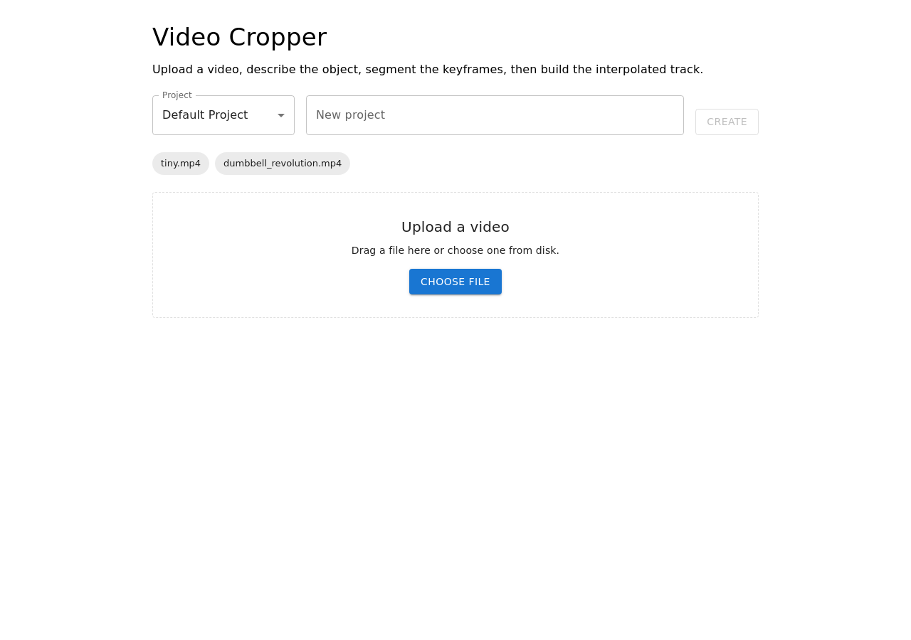
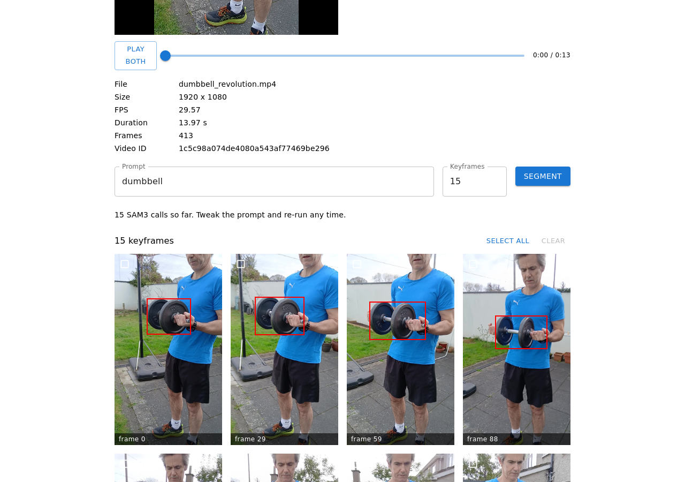
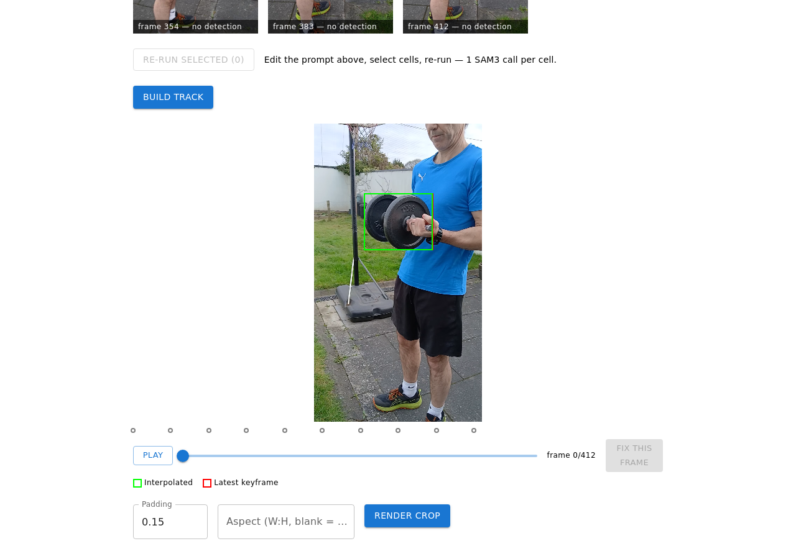
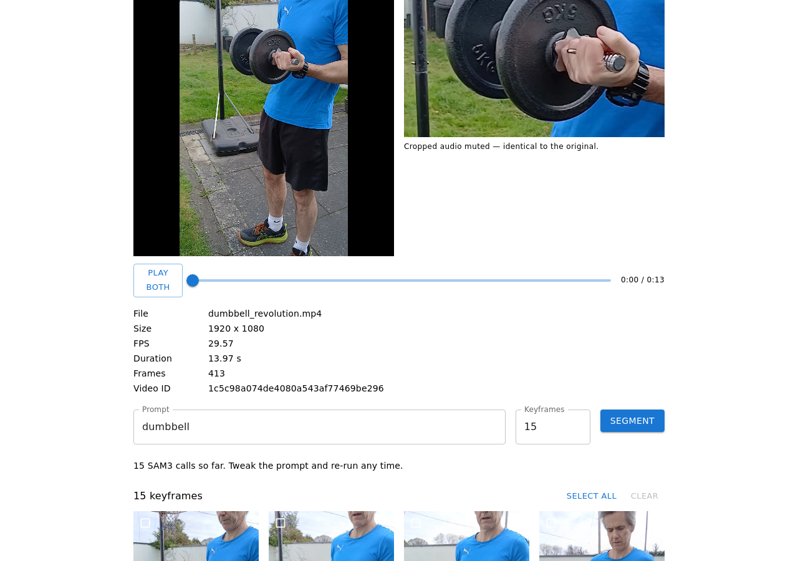

# Video Cropper with SAM3 Auto-Tracking

Upload a video, describe the object ("dumbbell", "dancer"), and get back a
cropped video that follows it. SAM3 segments a handful of sampled keyframes
(up to 4 concurrent calls); bounding boxes for every other frame are linearly
interpolated, and a fixed-size crop window tracks the smoothed center.



## Features

- **Upload + preview** — drop an mp4, see metadata and playback.
- **Keyframe sampling** — N evenly spaced keyframes (default 15), first/last
  inclusive; only keyframes ever leave the machine.
- **SAM3 text-prompt segmentation** — one call per keyframe, bbox + mask;
  misses stay explicit ("no detection"). Results stream into the grid live.
- **Review grid + selective re-run** — checkbox select one, several, or all
  cells and re-segment with a tweaked prompt (1 call per cell).
- **Interpolated track** — lerp x/y/w/h between keyframes, window-5 smoothing,
  edge holds; timeline scrubber with interpolated + latest-keyframe overlays.
- **Fixed-window render** — constant-size crop follows the smoothed center,
  padding + aspect-ratio options, audio preserved.
- **Fix frames** — "Fix this frame" segments one frame, splices it in,
  re-interpolates the affected span only, and re-renders.
- **Projects** — group videos, auto-created default, click a video to resume
  its keyframes/track/output.
- **Synced playback** — one Play button + seek slider drive original and
  cropped side by side, same frame.
- **Storage abstraction** — all persistence behind a `Storage` interface
  (filesystem today, MongoDB stubbed).





## Prerequisites

- [uv](https://docs.astral.sh/uv/) (Python env + deps; project uses Python 3.12)
- Node 20+ and npm (frontend is Vite + React 19 + MUI)
- ffmpeg: no system install needed — the backend uses the `imageio-ffmpeg`
  bundled binary, with `ffprobe` used when one happens to be installed
- A Meta AI key: `MODEL_API_KEY` (backend `.env` only, never the frontend)

## Quickstart

```bash
git clone <this-repo> && cd tracker

# 1. Python env + deps from the lockfile
uv sync

# 2. API key
cp .env.example .env
# edit .env: MODEL_API_KEY=your_key_here

# 3. Backend (http://127.0.0.1:8000, health at /health)
uv run uvicorn backend.main:app --host 127.0.0.1 --port 8000 \
  --log-config backend/log_config.json

# 4. Frontend, in a second terminal (http://localhost:5173)
cd frontend
npm install
npm run dev
```

Run the backend tests with `uv run pytest backend/tests -q` (67 tests).

## Usage walkthrough

1. **Upload** a video (or pick a previous one from the project chips to resume).
2. Type a **prompt**, set keyframe count, hit **Segment** — cells appear as
   each SAM3 call finishes.
3. Got misses? Edit the prompt, **select cells**, **Re-run selected**; when a
   prompt wins, select all and re-run the batch with it.
4. **Build track**, scrub the **timeline** (green = interpolated, red = latest
   keyframe). Drift somewhere? Move there and **Fix this frame**.
5. Set padding/aspect, **Render crop**, compare with **Play both**.

## API sketch

All JSON uses camelCase; bboxes are normalized 0–1 (`bbox: null` = miss).

```text
POST /api/videos/upload[?projectId=]        -> { videoId, metadata, originalUrl }
GET  /api/videos/{id}/status                -> { videoId, status, metadata, originalUrl }
GET  /api/videos/{id}/frames?numSamples=15  -> { videoId, frames[] }
POST /api/videos/{id}/segment               -> { keyframes[], sam3Calls }
GET  /api/videos/{id}/segment/stream        -> SSE: keyframe | done | error
GET  /api/videos/{id}/segment               -> stored keyframes (resume)
POST /api/videos/{id}/segment/selected      -> re-segment a subset
POST /api/videos/{id}/track {prompt}        -> { trackId }   (trackId == videoId)
GET  /api/videos/{id}/track                 -> { prompt, keyframes[], interpolatedBoxes[] }
POST /api/videos/{id}/keyframes {frameIdx}  -> fix frame, maybe re-render
POST /api/videos/{id}/render                -> { outputUrl, width, height, numFrames }
GET  /api/videos/{id}/output                -> cropped.mp4
GET  /api/projects  POST /api/projects  GET /api/projects/{projectId}
```

SAM3 cost model: N keyframes = N calls (max 4 in flight); each fix or
re-run cell = 1 call. Video never leaves the machine — only keyframe JPEGs
are uploaded, one per call.

## Storage backends

Filesystem (`data/`) by default. For MongoDB (local or Atlas), see
[docs/mongo.md](docs/mongo.md): set `STORAGE_BACKEND=mongodb`, import with
`scripts/import_to_mongo.py`, restart.

## Project layout

```text
tracker/
  README.md  PROJECT.md  PLAN.md  pyproject.toml  uv.lock  .env.example
  backend/
    main.py  config.py  log_config.json  logging_config.py
    models/schemas.py
    routers/videos.py  routers/projects.py
    services/video_service.py  frame_service.py  sam3_service.py
             track_builder.py  render_service.py  storage.py
             project_service.py
    tests/  (conftest.py + test_*.py, fixtures/tiny.mp4)
  frontend/
    package.json  vite.config.ts  src/App.tsx  src/api/client.ts
    src/components/Dropzone.tsx  VideoPreview.tsx  KeyframeGrid.tsx
                     Timeline.tsx
  docs/screenshots/*.png
  data/  (gitignored at runtime)
    uploads/{id}/original.* + meta.json   frames/{id}/{idx}.jpg
    masks/{id}/{idx}.png + keyframes.json outputs/{id}/track.json +
      render.json + cropped.mp4           projects/{id}.json
```

## Troubleshooting

- **Backend won't start / 500s on segment**: `MODEL_API_KEY` missing or blank
  in `.env` (repo root, not `frontend/`). The key is backend-only by design.
- **`localhost` hangs but `127.0.0.1` works**: proxy env vars are intercepting
  `localhost`. Either use `http://127.0.0.1:5173` or export
  `no_proxy=localhost,127.0.0.1` (lowercase; some tools ignore `NO_PROXY`).
- **Port busy**: another dev server is still up — check `lsof -i :5173`
  (frontend) / `:8000` (backend) and stop it; don't start a second copy.
- **Render takes minutes / UI unresponsive**: rendering re-encodes every frame
  on the single uvicorn worker. Start it and wait; the page recovers when the
  response lands.
- **Track build 400s**: every keyframe is a miss, so there is nothing to
  interpolate — re-run cells with a better prompt first.
- **Video won't play in some browsers**: outputs are H.264 mp4; any
  modern browser plays them. If a headless test browser shows black video,
  it lacks proprietary codecs — not an app bug.

## Roadmap

- Phase 10: Lightsail deployment (instance + static IP + DNS + TLS runbook)
- Phase 11: real MongoDB — done (see [docs/mongo.md](docs/mongo.md))

See `PROJECT.md` / `PLAN.md` for the full phase history and decisions.
